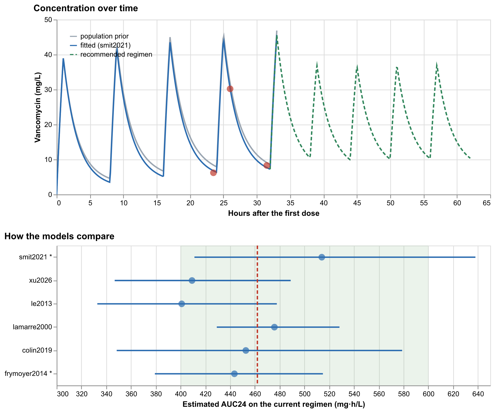
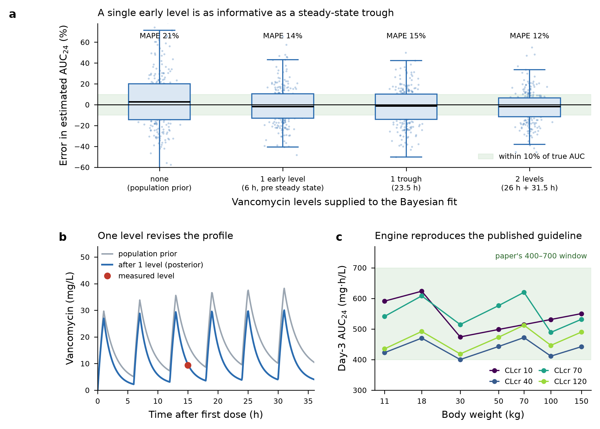

# VankeDoodle — Bayesian vancomycin dosing engine

A small, dependency-light Python engine for model-informed precision dosing (MIPD)
of vancomycin from neonates to adolescents. It estimates an individual patient's pharmacokinetics
from the doses given and whatever levels are available — including a single
non-steady-state level — and converts that into a dose and interval that put the
24-hour AUC on target.

The engine has no user-interface dependencies. The same functions back a
notebook, the command line, a Streamlit app, or an HTTP service.

> **Scope.** This software produces exposure estimates. It does not make clinical
> decisions, and nothing here substitutes for the judgement of a clinician with
> the full patient context. It has not yet been validated against clinical data.

---

## Install

New to this? [INSTALL.md](INSTALL.md) is a step-by-step guide written for someone
who has never used a terminal. The short version:

```bash
pip install -e .            # engine only (numpy, scipy)
pip install -e ".[web]"     # plus the interface (streamlit, altair, pandas)
pip install -e ".[dev]"     # plus pytest
```

## The interface

```bash
streamlit run app.py
```



One page: patient in the sidebar, doses and levels in the middle, results below.
Charts are interactive - hover to read any value. `app.py` is a thin layer over
`evaluate()`; the chart builders in `app_charts.py` are pure functions of the
response, so both are tested headlessly with Streamlit's `AppTest`.

## Use it in two calls

```python
from vankedoodle import start_dose, assess

# 1. Before any level has been drawn
print(start_dose(weight_kg=20, age_years=6, height_cm=115, scr=0.4).summary())
# Recommended: 300 mg IV every 6 h over 1 h (1200 mg/day, 60.0 mg/kg/day)
# Predicted steady-state AUC24 = 514 mg*h/L (90% CI 314-810); P(AUC24 in target) = 52%

# 2. After a level comes back
a = assess(
    patient={"weight_kg": 20, "age_years": 6, "height_cm": 115, "scr": 0.4},
    regimen={"dose_mg": 300, "interval_h": 6, "n_doses": 4, "start": "2026-01-01 08:00"},
    levels=[("2026-01-01 23:00", 9.4)],
    model="smit2021",          # or "xu2026", "le2013"
)
print(a.summary())
```

Times may be given as datetimes/strings or as plain hours after the first dose.

## Population models

Any shipped model can be used as the prior by name. The structural form is part
of the model, so one- and two-compartment priors are interchangeable everywhere:

| `model=` | Structure | Population | Covariates on CL |
|---|---|---|---|
| `smit2021` *(default)* | 2-compartment | 1–18 y, 1892 children, obesity and renal dysfunction | total body weight^0.745, bedside Schwartz CLcr capped at 120 |
| `xu2026` | 2-compartment | 3 months–18 y, 627 children, externally validated at 3 centres | weight allometric to 70 kg, postmenstrual-age maturation, creatinine (µmol/L) vs an age-adjusted reference |
| `le2013` | 1-compartment | ≥ 3 months, 702 children | weight^0.75, (0.48/SCr)^0.361, (ln age in days / 7.8)^0.995 |
| `lamarre2000` | 2-compartment | < 18 y, 78 patients, single centre | linear in original-Schwartz creatinine clearance, plus a weight term |
| `colin2019` | 2-compartment | neonate to elderly, pooled across 14 studies | weight^0.75, PMA maturation, age-related decline, creatinine (mg/dL) vs a PMA-based reference |
| `frymoyer2014` | 1-compartment | neonates, level III NICU, 249 patients | weight^0.75, PMA maturation, (1/SCr)^0.267 |

`colin2019` and `frymoyer2014` are the two that cover neonates; `colin2019` is the
only one spanning neonates and older children in a single prior.

```python
import vankedoodle as vd
print(vd.describe_models())                 # names, structure, required covariates
rows = vd.compare_models(patient, regimen, levels)   # fit all of them side by side
```

`compare_models()` fits the same patient under every model and returns individual
clearance, the AUC on the current regimen, the predicted value at each measured
level and the recommended dose — which is the comparison the validation study needs.
A model whose covariates are missing is reported with the reason, not skipped silently —
so running all six on one patient shows you which are applicable and how far they diverge.

Each model declares what it requires (`vd.get_model("xu2026").required`) and raises a
named error if a covariate is absent, warns when a covariate falls outside the range
of its source population, and converts creatinine units itself — `scr_mg_dl` and
`scr_umol_l` are interchangeable on `Patient`, as are `age_years` and
`postnatal_age_days` / `gestational_age_weeks` for forming postmenstrual age.

Adding a model means appending one `PopPKModel` to the registry:

```python
vd.register_model(vd.PopPKModel(
    name="my_model", label="...", reference="...",
    typical=lambda pt: {"CL": ..., "V": ...},      # or CL, V1, Q, V2
    eta_params=("CL", "V"), omega=vd.omega_from_cv([0.30, 0.20]),
    sigma_prop=0.15, required=("weight_kg", "scr_mg_dl"),
))
```

## A JSON contract for front ends

`evaluate()` takes one plain-JSON case and returns one document with everything a
user interface needs — the fit, the exposure on the current regimen, the
recommendation and its alternatives, a what-if evaluation, plot-ready curves, the
two-level Sawchuk-Zaske result where the levels allow it, and the comparison
between the two methods:

```python
from vankedoodle import evaluate
response = evaluate({
    "patient": {"weight_kg": 23, "age_years": 7, "height_cm": 122, "scr_mg_dl": 0.33},
    "regimen": {"dose_mg": 450, "interval_h": 8, "n_doses": 5,
                "start": "2026-03-02 08:00"},
    "levels": [{"time": "2026-03-03 07:30", "conc_mg_l": 6.2}],
    "options": {"model": "all", "series": True},
})
```

A front end reads values out of that response rather than recomputing anything,
which keeps the clinical logic in one tested place. Problems a clinician could
plausibly cause come back as messages, not exceptions; a model that lacks a
covariate is reported in its own entry while the others still run. The two-level
method is detected automatically from the dosing history and, when it cannot be
computed, says why in words meant for the user.

Every evaluation flattens to one row for the study database:

```python
from vankedoodle import append_case, case_record
append_case("cases.jsonl", case_record(response, model="smit2021",
                                       extra={"study_id": "PCH-07"}))
```

See [API.md](API.md) for the field-by-field contract and `example_case.json` for a
complete request.

## From the command line

```bash
python -m vankedoodle models
python -m vankedoodle evaluate example_case.json --record cases.jsonl
python -m vankedoodle start  --weight 20 --age 6 --height 115 --scr 0.4 --nomogram
python -m vankedoodle assess --model xu2026 --weight 20 --age 6 --height 115 --scr 0.4 \
    --dose 300 --interval 6 --n-doses 4 --start "2026-01-01 08:00" \
    --level "2026-01-01 23:00,9.4"
```

Add `--json` for machine-readable output (this is the hook a web front end or an
EHR integration should use).

---

## What the engine does

**Estimation.** Maximum a posteriori (MAP) Bayesian estimation of the individual
random effects: the population model supplies the prior, the measured levels
supply a proportional-error likelihood, and the posterior mode gives the
patient's own parameters. With no levels the result is exactly the population
prediction; each level moves it toward the individual. A Laplace approximation
at the mode gives the posterior covariance, which is where the 90 % AUC interval
and the probability of being in target come from. As in any MAP estimator with a
proportional error model, the objective carries a log-variance term that biases
the mode slightly toward higher clearance; the effect scales with the model's
residual error and is a few percent for a model with 29 % proportional error.

**Pharmacokinetics.** Concentrations and exposure come from the exact solution of
the linear state-space system, augmented with a state that integrates the central
concentration — so AUC over any window is analytic rather than a trapezoid over a
grid. One- and two-compartment models differ only in the size of that matrix.
Irregular, missed, delayed and overlapping infusions are handled by construction,
and no steady-state assumption is made anywhere.

**Dose selection.** The daily dose follows from AUC₂₄,ss = total daily dose / CL,
which is exact for any linear model. The interval is a clinical convention
(`default_interval`: < 30 kg q6h, 30–70 kg q8h, > 70 kg q12h, lengthened at low
CLcr) rather than something derived from the model, because models parameterise
the peripheral compartment very differently — Xu 2026 carries a deep compartment
giving a 132 h terminal half-life, which would drive any half-life-based rule to
absurd intervals. Candidates are ranked by landing in the AUC window, keeping the
predicted peak below a ceiling, and closeness to that conventional interval;
`interval_h=` fixes it outright.

**Reporting.** `auc24` is the steady-state value; `auc24_day`, `cmax` and
`ctrough` are the actual values on day 3 of therapy. The distinction matters for
models with a slowly-equilibrating compartment, where day-3 exposure is
measurably below the eventual steady state.

**Reference method.** `sawchuk_zaske()` implements the two-level steady-state
calculation used as the current standard of care, and `mpe_mape()` computes the
bias and precision statistics named in the protocol — so the Aim 1 comparison is
a few lines of code against the same objects.

---

## Validation



The panels below were produced with `smit2021`.

**(a)** Across 250 virtual subjects, MAP estimates of AUC₂₄ recover the truth with
little bias; a single level drawn 6 h after the first dose — well before steady
state — is as informative as a steady-state trough (MAPE 14 % vs 15 %), which is
the proof of concept Aim 2 sets out to test in real patients. **(b)** One level
visibly revises the predicted profile away from the population prior. **(c)**
Dosing the Smit paper's own Table III guideline through this engine reproduces its
simulated day-3 exposures: AUC₂₄ 400–623 mg·h/L across all weight and renal
strata the paper displays (35/35 inside its stated 400–700 window) and troughs
7.4–23.9 mg/L against the paper's 7.2–23.

Those virtual subjects are a test of the estimator, not clinical evidence. They
say nothing about performance in real patients — that is what the prospective
study is for.

`pytest` runs 96 tests covering: the published typical parameter values and every
covariate term of all six models, reproduced at covariate values where each term
reduces to a known constant; each maturation function equalling 0.5 at its own
midpoint; Colin's clearance reaching 90 % of adult by 2 years PMA and its published
creatinine sensitivity (±0.2 mg/dL → +13.8 %/−12.2 %) reproduced to three figures;
Frymoyer's typical clearance at its cohort median; Xu's nine published simulated
trough strata reproduced inside their IQRs; the Schwartz k-coefficient
selection by age, sex and preterm status;
creatinine unit round-tripping and postmenstrual-age construction; mass balance
(AUC to infinity = dose/CL) and steady-state AUC = dose/CL at every interval, in
one and two compartments; the one-compartment limit against the closed-form
infusion equation; superposition of overlapping and delayed doses; prior recovery
with no levels; recovery of known individual parameters from noise-free levels;
posterior narrowing as levels accumulate; simulation-based bias and precision;
agreement of the models' typical clearance within a factor where their populations overlap; the Smit Table
III reproduction above; round-tripping the Sawchuk-Zaske method through a
simulated one-compartment patient; the input-validation paths; and the JSON contract — serialisability with no numpy types leaking, errors returned as data, per-model failure isolation, clock-time and hours-after-dose agreement, plot-ready series, two-level auto-detection and each reason it declines, and case records round-tripping through a file.

```bash
pytest -q        # 96 passed
```

---

## Layout

| File | Contents |
|---|---|
| `vankedoodle/core.py` | `Patient`, `Dose`, `Level`, `DosingHistory`, time handling, unit conversion, bedside Schwartz |
| `vankedoodle/models.py` | `PopPKModel`, the model registry, Smit 2021 / Xu 2026 / Le 2013 |
| `vankedoodle/pk.py` | exact one- and two-compartment solver (concentrations and AUC) |
| `vankedoodle/bayes.py` | MAP estimation, posterior covariance, virtual-subject simulation |
| `vankedoodle/dosing.py` | exposure prediction, dose/interval selection, Smit Table III nomogram |
| `vankedoodle/reference.py` | Sawchuk-Zaske two-level AUC, MPE/MAPE |
| `vankedoodle/workflow.py` | `start_dose()`, `assess()`, `compare_models()` |
| `vankedoodle/api.py` | `evaluate()` JSON contract, study case records |
| `vankedoodle/cli.py` | `python -m vankedoodle` |

## Limitations

- Each model is valid over its own population, declared in `model.population`.
  Out-of-range covariates raise warnings via `model.check(patient)`, but only for
  models whose source publication tabulates the range — for the others the
  population is described in `model.notes` and no numeric band is asserted.
- Models carry between-subject variability only on the parameters their authors
  estimated it for; the remaining parameters are held at typical values during
  the fit, exactly as published.
- Two models required a documented departure from their publication, recorded in
  `model.notes` rather than hidden: Lamarre 2000 places its 45 % variability on
  the creatinine-clearance *slope*, which this implementation applies to the whole
  of clearance, and its additive error floor is not tabulated so only the 6.5 %
  proportional part is used — that is far tighter than the other models, so
  Lamarre fits track measured levels very closely and shrink toward the prior very
  little. Colin 2019's two study-specific effects (haematological malignancy on
  CL, heel-prick sampling on V1 and Q2) are not applied, since they describe its
  source cohorts rather than a new patient.
- Xu 2026's volumes are unusual and worth knowing about before you read its
  concentration predictions. Its central volume is 1.22 L/kg — two to three times
  the other models' — and its steady-state volume 5.3 L/kg, against the 0.4–0.7 L/kg
  usually quoted for vancomycin, with a peripheral compartment that equilibrates
  very slowly. Predicted peaks are correspondingly low (21.6 mg/L where Smit gives
  47.6 on the same regimen) and peak-to-trough fluctuation flat. This is faithful to
  the publication, not a transcription error: the implementation reproduces all nine
  of the paper's own simulated trough strata inside their published IQRs, and that is
  a standing test. It leaves AUC₂₄ and the recommended dose untouched, since both
  follow from clearance alone — but do not use that model to predict peaks or to
  support a trough-based decision.
- The models disagree, and that is informative rather than a defect. For a 6-year-old,
  20 kg, SCr 0.4 mg/dL, typical clearance is 2.21–2.83 L/h across the four models
  valid there. For a 2.9 kg neonate at 39 weeks PMA with SCr 0.6 mg/dL, Frymoyer
  gives 0.248 L/h and Colin 0.172 L/h — a 44 % difference between the NICU-specific
  model and the pooled one. `compare_models()` exists to make that visible.
- Xu 2026 also reports inter-occasion variability on clearance (18.7 % CV). It is
  not applied here, because a single fit has no occasion structure.
- Below-limit-of-quantification levels must be handled before fitting; the
  proportional error model requires concentrations above zero.
- AUC targets assume MIC = 1 mg/L, as in the 2020 consensus guideline. Xu 2026
  was developed against a 400–650 mg·h/L window rather than 400–600; pass
  `target_low` / `target_high` to match.

## Licence

MIT - see [LICENSE](LICENSE). The licence includes an explicit disclaimer of
warranty, which matters here: this is a research tool, it has not been validated
against clinical data, and it does not make clinical decisions.
